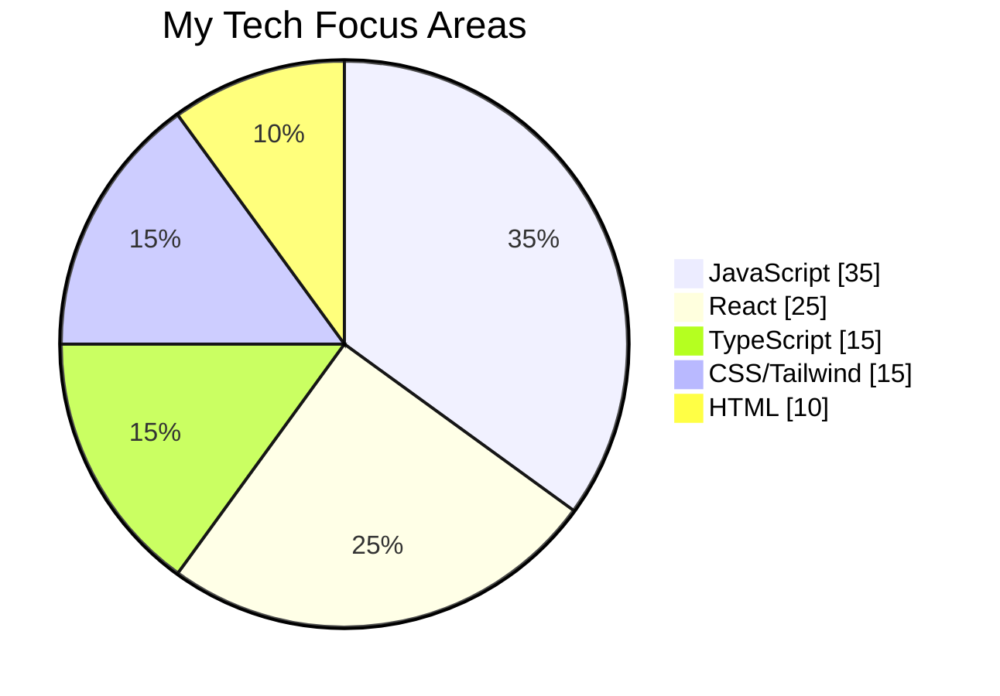
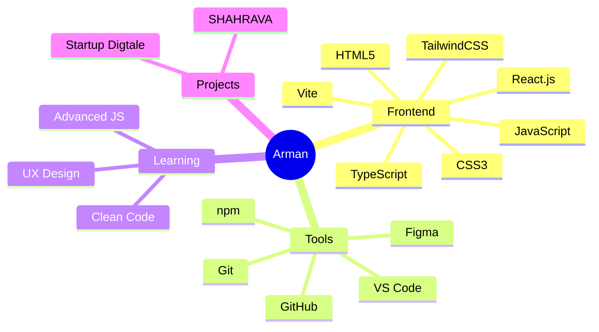
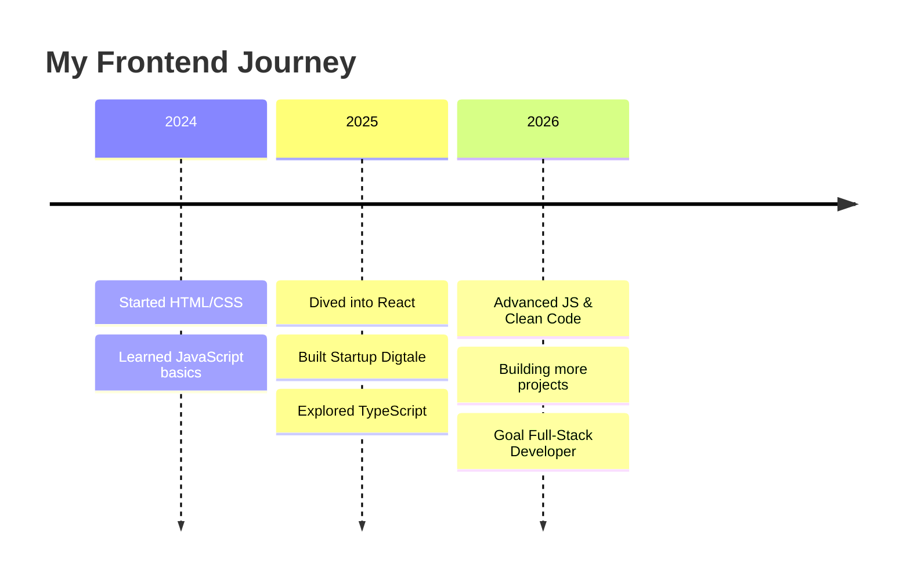
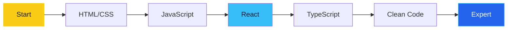
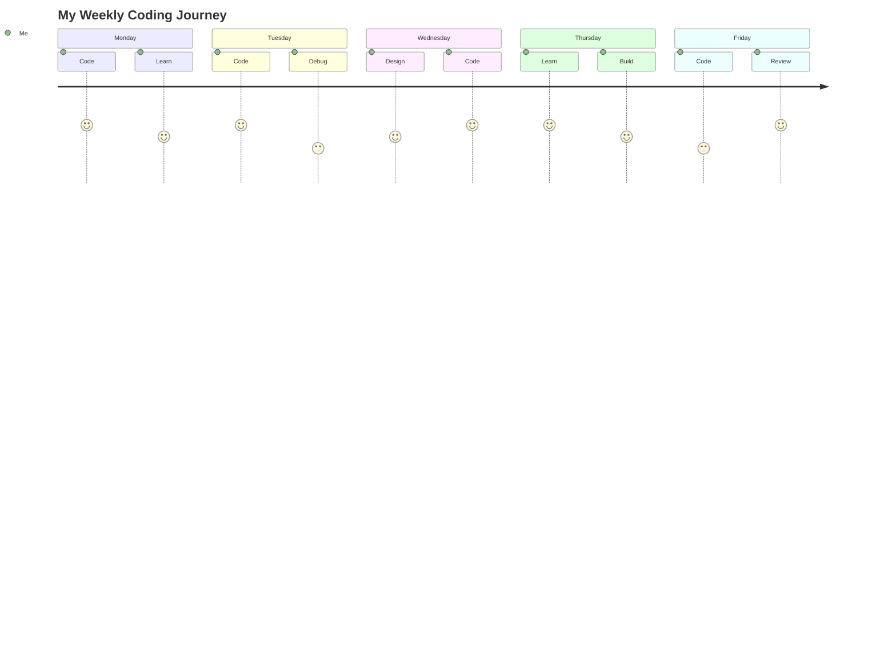

<!-- ═══════════════════════════════════════════════════════════════════════
     🎨 MEGA HEADER
     ═══════════════════════════════════════════════════════════════════════ -->
<div align="center">


<a href="https://git.io/typing-svg">
  
</a>

<br/>

<a href="https://git.io/typing-svg">
  
</a>

<br/><br/>

<a href="https://github.com/ArmanGhM">
  
</a>
<a href="https://startup-digtale.vercel.app/">
  
</a>
<a href="https://www.linkedin.com/in/arman-gholamaly-478769437">
  
</a>

<br/><br/>


<br/><br/>

> ⚡ *"I build, experiment, and continuously improve my frontend development skills."*

<br/>


</div>

---

<!-- ═══════════════════════════════════════════════════════════════════════
     01 — ABOUT ME
     ═══════════════════════════════════════════════════════════════════════ -->
<div align="center">

</div>


Hey! I'm **Arman**, a frontend developer passionate about creating modern and responsive web experiences.

```javascript
const arman = {
  role      : "Frontend Developer",
  focus     : ["JavaScript", "React.js"],
  interests : ["Clean UI", "Responsive Design", "UX"],
  learning  : ["TypeScript", "Advanced JavaScript", "Clean Code"],
  openTo    : ["Collaboration", "Learning"],
  motto     : "Build. Learn. Improve. Repeat. ⚡",
  coffee    : Infinity
};
```

- 💻 Focused on **JavaScript** and **React.js**
- 🎨 Interested in clean UI, responsive design, and user experience
- 🧩 Learning through practical projects and real-world challenges
- 🌱 Currently learning **TypeScript** and advanced JavaScript
- 🤝 Open to collaboration and learning from other developers

<br clear="right"/>

<div align="center">

</div>

<div align="center">

</div>

---

<!-- ═══════════════════════════════════════════════════════════════════════
     02 — TECH STACK
     ═══════════════════════════════════════════════════════════════════════ -->
<div align="center">

</div>

<div align="center">

### 🧠 Languages & Frontend


### 🛠️ Tools & Workflow


### 📚 Learning Path


</div>

<br/>



<div align="center">

</div>

---

<!-- ═══════════════════════════════════════════════════════════════════════
     03 — GITHUB STATS OVERLOAD
     ═══════════════════════════════════════════════════════════════════════ -->
<div align="center">

</div>

<div align="center">


<br/>


<br/><br/>


<br/><br/>


<br/><br/>


<br/><br/>


<br/><br/>


</div>

<div align="center">

</div>

---

<!-- ═══════════════════════════════════════════════════════════════════════
     04 — CURRENTLY LEARNING
     ═══════════════════════════════════════════════════════════════════════ -->
<div align="center">

</div>

<div align="center">

| 📘 Skill | 🎯 Focus | 📊 Progress |
|:--|:--|:--|
| **TypeScript** | Static typing & type-safe JavaScript | `████████░░` 80% |
| **Advanced JavaScript** | Core concepts & modern patterns | `█████████░` 90% |
| **React.js** | Component design & state management | `████████░░` 75% |
| **Clean Code** | Readability & maintainability | `███████░░░` 70% |

</div>

<br/>



<div align="center">

</div>

---

<!-- ═══════════════════════════════════════════════════════════════════════
     05 — FEATURED PROJECTS
     ═══════════════════════════════════════════════════════════════════════ -->
<div align="center">

</div>

<table>
<tr>
<td width="50%" valign="top">

<div align="center">

### 🌐 Startup Digtale

<a href="https://startup-digtale.vercel.app/">
  
</a>

A startup website showcasing a modern frontend interface built with React.

**✨ Highlights**
- 📱 Responsive user interface
- 🧩 Component-based development
- 🌍 Live deployment

**🛠️ Technologies**


<a href="https://github.com/ArmanGhM/startMpv">
  
</a>

</div>

</td>
<td width="50%" valign="top">

<div align="center">

### 🏙️ SHAHRAVA

<a href="https://github.com/ArmanGhM/shahrava">
  
</a>

A Persian city-discovery project focused on exploring cities and location-related information.

**✨ Highlights**
- 🔍 City search experience
- 🌐 API-based data exploration
- 🇮🇷 Persian RTL interface

**🛠️ Technologies**


<a href="https://github.com/ArmanGhM/shahrava">
  
</a>

</div>

</td>
</tr>
</table>

<br/>

<div align="center">

### 📌 Pinned Repos

<a href="https://github.com/ArmanGhM/startMpv">
  
</a>
<a href="https://github.com/ArmanGhM/shahrava">
  
</a>

</div>

<div align="center">

</div>

---

<!-- ═══════════════════════════════════════════════════════════════════════
     06 — CODING ACTIVITY
     ═══════════════════════════════════════════════════════════════════════ -->
<div align="center">

</div>

<div align="center">


<br/><br/>

### 🔥 Contribution Heatmap


</div>

<div align="center">

</div>

---

<!-- ═══════════════════════════════════════════════════════════════════════
     07 — FUN ZONE
     ═══════════════════════════════════════════════════════════════════════ -->
<div align="center">

</div>

<div align="center">

### 💬 Dev Quote of the Day


<br/><br/>

### 😄 Random Programming Joke


<br/><br/>

### 🎲 Random Dev Meme


</div>

<div align="center">

</div>

---

<!-- ═══════════════════════════════════════════════════════════════════════
     08 — SKILLS ROADMAP (Mermaid Diagrams)
     ═══════════════════════════════════════════════════════════════════════ -->
<div align="center">

</div>

### 🎯 My Journey



### 🧭 Learning Path



### 🌟 Weekly Activity



<div align="center">

</div>

---

<!-- ═══════════════════════════════════════════════════════════════════════
     09 — CONNECT
     ═══════════════════════════════════════════════════════════════════════ -->
<div align="center">

</div>

<div align="center">

<a href="https://github.com/ArmanGhM">
  
</a>
<a href="https://www.linkedin.com/in/arman-gholamaly-478769437">
  
</a>
<a href="https://startup-digtale.vercel.app/">
  
</a>

<br/><br/>

<a href="https://git.io/typing-svg">
  
</a>

</div>

---

<!-- ═══════════════════════════════════════════════════════════════════════
     🎬 MEGA FOOTER
     ═══════════════════════════════════════════════════════════════════════ -->
<div align="center">


###    

**Build. Learn. Improve. Repeat.** ⚡

<a href="https://git.io/typing-svg">
  
</a>

<sub>Made with ❤️ by Arman Gholamaly</sub>

<br/>


</div>
