<!--
  Profile README for github.com/ArmanGhM  (repository: ArmanGhM/ArmanGhM)

  - Every visual is a self-hosted SVG in ./assets: no scripts, no external fonts, no third-party image services.
  - The stats card (assets/stats.svg) is generated from public GitHub data by .github/workflows/stats.yml.
  - Colour theme: the big visuals cycle through red, amber, mint, blue and violet (about 32 s per loop) using one SVG filter
    animation. The mascot keeps its natural colours (only its lighting is tinted), and the tech tiles keep their brand colours.
  - The only external image is the optional profile-views counter in the footer (komarev.com). Delete it if you prefer zero third parties.
-->

  <a href="https://github.com/ArmanGhM">
    
  </a>

  

  Hi, I'm <b>Arman</b>, a frontend developer who enjoys building modern, responsive and easy-to-use interfaces. 
  I work mostly with <b>React</b> and <b>JavaScript</b>, care about UI/UX and clean code, and learn best by shipping real projects. 
  I'm currently adding <b>TypeScript</b> and <b>Next.js</b> to my toolkit, and I'm glad to collaborate on team and open-source work.

  <a href="https://github.com/ArmanGhM">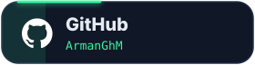</a>
  
  <a href="https://startup-digtale.vercel.app/">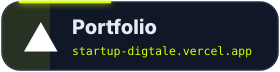</a>

  

<h2 align="center"></h2>

  

 

- Building interfaces with HTML, CSS, JavaScript and React, with a focus on clean, component-based code
- Interested in responsive, thoughtfully designed UI/UX and maintainable code
- Practicing teamwork through Git branches, pull requests and code review
- Open to collaboration, feedback and new opportunities, including open-source work

<h2 align="center"></h2>

  <b>Core</b> 
    

  <b>Styling</b> 
    

  <b>Frontend ecosystem</b> 
     

  <b>Tools</b> 
      

  <b>Currently learning</b> 
    

  Tiles with a dashed violet frame and a <b>LEARNING</b> tag are technologies I'm still learning, not areas of expertise. 
  Also practicing: responsive web design and Local Storage.

<h2 align="center"></h2>

<a href="https://startup-digtale.vercel.app/"></a>

A multi-section startup website built with React and Vite. It uses React Router for navigation, Tailwind CSS 4 for styling and i18next for localization, supports dark mode, and is deployed on Vercel.

`React 19` `Vite` `Tailwind CSS 4` `React Router 7` `i18next`

[Live demo](https://startup-digtale.vercel.app/) · [Source code](https://github.com/ArmanGhM/startMpv)

 

<a href="https://github.com/ArmanGhM/shahrava"></a>

**شهرآوا | کاوشگر تعاملی شهرهای جهان**

A Persian-language interactive explorer for discovering cities, attractions and travel-related information. Built with HTML, CSS, JavaScript and Tailwind CSS 4, with Navigo for client-side routing and a small Express dev server. It is still in development, so there is no live demo yet.

`HTML` `CSS` `JavaScript` `Tailwind CSS 4` `Navigo`

[Repository](https://github.com/ArmanGhM/shahrava)

 

<a href="https://github.com/srcgrp/gang-of-forty/pull/99"></a>

**سبزکاله | فروشگاه آنلاین سوپرمارکت**

A Persian (RTL) online supermarket built with TypeScript and Vite as my Week 3 project in the Gang of Forty course. It uses four npm packages (Fuse.js for fuzzy search, Notyf for toasts, canvas-confetti and @formkit/auto-animate), a cart saved in Local Storage, and light and dark themes. The pull request is open: the first review round led to follow-up fixes, and it has not been merged yet.

`TypeScript` `Vite` `npm` `Fuse.js` `Notyf`

[Pull request #99](https://github.com/srcgrp/gang-of-forty/pull/99)

<!-- TODO: when SabzKaleh is published as its own repository, add its link next to the pull request link above. -->

 

<a href="https://github.com/srcgrp/gang-of-forty"></a>

A shared repository from the Gang of Forty course, where participants build and ship projects week by week through branches, pull requests and code review. It is where I practise real team workflow: working in my own `shops/deep-module` folder, responding to review feedback and keeping CI checks passing.

`Git` `GitHub` `Pull requests` `Code review`

[Repository](https://github.com/srcgrp/gang-of-forty) · [My pull request #99](https://github.com/srcgrp/gang-of-forty/pull/99)

<!-- Note: https://github.com/ArmanGhM/gang-of-forty does not exist (404). The real repository is srcgrp/gang-of-forty. -->

<h2 align="center"></h2>

  

  Generated daily by a GitHub Action from public GitHub data (see <code>.github/workflows/stats.yml</code>). Private activity is not counted, and nothing here is hand-written.

<h2 align="center"></h2>

  

 

**What I'm working on next**

- Strengthen modern JavaScript fundamentals
- Build more complete React projects
- Practice TypeScript step by step, then move on to Next.js
- Improve responsive design and accessibility
- Get more comfortable with Git workflows and code review
- Learn more about frontend performance and maintainability

<h2 align="center"></h2>

  If you're building something on the frontend, have feedback on my code, or want to collaborate, I'd be glad to hear from you.

  
  
  

 

  
    
  

