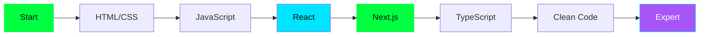

<div align="center">


<a href="https://git.io/typing-svg">
  
</a>

<br/>

<a href="https://git.io/typing-svg">
  
</a>

<br/><br/>

<a href="https://github.com/ArmanGhM">
  
</a>
<a href="https://startup-digtale.vercel.app/">
  
</a>
<a href="https://www.linkedin.com/in/arman-gholamaly-478769437">
  
</a>

<br/><br/>


<br/><br/>

> ⚡ *"I build, experiment, and continuously improve my frontend development skills."*

<br/>


</div>

---

<div align="center">

</div>


Hey! I'm **Arman**, a frontend developer passionate about creating modern and responsive web experiences with **React** and **Next.js**.

```javascript
const arman = {
  role      : "Frontend Developer",
  stack     : ["React.js", "Next.js", "JavaScript", "TypeScript"],
  focus     : ["Clean UI", "Responsive Design", "UX"],
  learning  : ["TypeScript", "Next.js Advanced", "Clean Code"],
  openTo    : ["Collaboration", "Learning"],
  motto     : "Build. Learn. Improve. Repeat. ⚡",
  coffee    : Infinity
};
```

- 💻 Focused on **React.js**, **Next.js** and **JavaScript**
- ⚡ Building **fast, SEO-friendly** apps with **Next.js App Router**
- 🎨 Interested in clean UI, responsive design, and user experience
- 🧩 Learning through practical projects and real-world challenges
- 🌱 Currently learning **TypeScript** and **Advanced Next.js**
- 🤝 Open to collaboration and learning from other developers

<br clear="right"/>

<div align="center">

</div>

<div align="center">

</div>

---

<div align="center">

</div>

<div align="center">

### 🧠 Languages & Frontend


### 🛠️ Tools & Workflow


### 📚 Learning Path


</div>

<div align="center">

</div>

---

<div align="center">

</div>

<div align="center">


<br/><br/>


<br/><br/>


<br/><br/>


</div>

<div align="center">

</div>

---

<div align="center">

</div>

<div align="center">

| 📘 Skill | 🎯 Focus | 📊 Progress |
|:--|:--|:--|
| **Next.js** | App Router, SSR, ISR, Server Components | `███████░░░` 70% |
| **TypeScript** | Static typing and type-safe JavaScript | `████████░░` 80% |
| **Advanced JavaScript** | Core concepts and modern patterns | `█████████░` 90% |
| **React.js** | Component design and state management | `████████░░` 85% |
| **Clean Code** | Readability and maintainability | `███████░░░` 70% |

</div>

<div align="center">

</div>

---

<div align="center">

</div>

<table>
<tr>
<td width="50%" valign="top">

<div align="center">

### 🌐 Startup Digtale

<a href="https://startup-digtale.vercel.app/">
  
</a>

A startup website showcasing a modern frontend interface built with React.

**✨ Highlights**

- 📱 Responsive user interface
- 🧩 Component-based development
- 🌍 Live deployment on Vercel

**🛠️ Technologies**


<a href="https://github.com/ArmanGhM/startMpv">
  
</a>

</div>

</td>
<td width="50%" valign="top">

<div align="center">

### 🏙️ SHAHRAVA

<a href="https://github.com/ArmanGhM/shahrava">
  
</a>

A Persian city-discovery project focused on exploring cities and location-related information.

**✨ Highlights**

- 🔍 City search experience
- 🌐 API-based data exploration
- 🇮🇷 Persian RTL interface

**🛠️ Technologies**


<a href="https://github.com/ArmanGhM/shahrava">
  
</a>

</div>

</td>
</tr>
</table>

<br/>

<div align="center">

### 📌 Pinned Repos

<a href="https://github.com/ArmanGhM/startMpv">
  
</a>
<a href="https://github.com/ArmanGhM/shahrava">
  
</a>

</div>

<div align="center">

</div>

---

<div align="center">

</div>

<div align="center">


<br/><br/>

### 🔥 Contribution Heatmap


</div>

<div align="center">

</div>

---

<div align="center">

</div>

<div align="center">

### 💬 Dev Quote of the Day


<br/><br/>

### 😄 Random Programming Joke


<br/><br/>

### 🎲 Random Dev Meme


</div>

<div align="center">

</div>

---

<div align="center">

</div>

### 🎯 My Journey


### 🧭 Learning Path



<div align="center">

</div>

---

<div align="center">

</div>

<div align="center">

<a href="https://github.com/ArmanGhM">
  
</a>
<a href="https://www.linkedin.com/in/arman-gholamaly-478769437">
  
</a>
<a href="https://startup-digtale.vercel.app/">
  
</a>

<br/><br/>

<a href="https://git.io/typing-svg">
  
</a>

</div>

---

<div align="center">


###    

**Build. Learn. Improve. Repeat.** ⚡

<a href="https://git.io/typing-svg">
  
</a>

<sub>Made with ❤️ by Arman Gholamaly</sub>

<br/>


</div>
