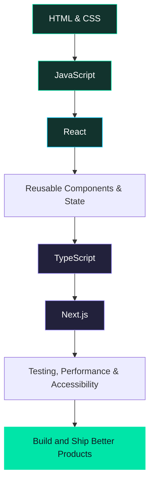

👋 About Me
Hi! I'm Arman Gholamly, a frontend developer and Computer Engineering student who enjoys turning ideas into clean, responsive, and interactive web experiences.

I learn best by building projects, exploring how things work, and improving my code step by step. My current focus is strengthening my JavaScript and React foundations, creating polished user interfaces, and collaborating on real-world projects.
const arman = {
  role: "Frontend Developer",
  education: "Computer Engineering Student",
  focus: [
    "Frontend Development",
    "Responsive UI",
    "Reusable Components",
    "Clean and Maintainable Code"
  ],
  technologies: {
    core: ["HTML", "CSS", "JavaScript"],
    frontend: ["React", "Tailwind CSS", "Bootstrap"],
    tools: ["Git", "GitHub", "Vite", "npm", "VS Code"],
    currentlyLearning: ["TypeScript", "Advanced JavaScript", "Next.js"]
  },
  interests: [
    "Building useful web products",
    "UI/UX and visual design",
    "Open-source collaboration",
    "Continuous learning"
  ],
  motto: "Build. Learn. Improve. Repeat. ⚡"
};
- 💻 Building frontend projects with HTML, CSS, JavaScript, and React
- 🎨 Interested in accessible, responsive, and thoughtfully designed interfaces
- 🧩 Practicing component-based architecture and maintainable code
- 🌱 Continuing to learn TypeScript and deepen my frontend knowledge
- 🤝 Interested in collaboration, code reviews, and learning from other developers
- 📍 Always looking for a chance to turn what I learn into something practical
🧰 Tech Stack

Frontend

Currently Exploring

Tools & Workflow

Note: The technologies in “Currently Exploring” represent my learning path, not a claim of professional mastery.

🚀 Featured Projects
<table>
  <tr>
    <td width="50%" valign="top">
      <h3 align="center">🌐 Startup Digtale</h3>
      

        
        
      

      
A modern startup website focused on a polished frontend experience and reusable UI.

      <ul>
        <li>Responsive interface and page layouts</li>
        <li>Component-based React development</li>
        <li>Deployed with Vercel</li>
      </ul>
      
<strong>Tech:</strong> React, JavaScript, CSS, Vite

    </td>
    <td width="50%" valign="top">
      <h3 align="center">🏙️ SHAHRAVA — شهرآوا</h3>
      

        
      

      
A Persian, right-to-left city-discovery project designed to help people explore cities and location-related information.

      <ul>
        <li>Persian RTL interface</li>
        <li>City-search and discovery experience</li>
        <li>Exploration of public APIs and city data</li>
      </ul>
      
<strong>Tech:</strong> HTML, CSS, JavaScript, Tailwind CSS

    </td>
  </tr>
  <tr>
    <td width="50%" valign="top">
      <h3 align="center">🛍️ SabzKaleh — سبزکاله</h3>
      
An online supermarket concept focused on a modern shopping experience. This project is part of my practice with TypeScript and the Vite ecosystem.

      
<strong>Tech:</strong> TypeScript, Vite, npm

      
<em>Repository link can be added when the project is published.</em>

    </td>
    <td width="50%" valign="top">
      <h3 align="center">🤝 Open-source & Team Practice</h3>
      
Learning collaborative workflows through Git, branches, pull requests, review feedback, and working with shared repositories.

      
<a href="https://github.com/srcgrp/gang-of-forty">gang-of-forty repository</a>

      
<strong>Focus:</strong> Git, GitHub, pull requests, collaboration

    </td>
  </tr>
</table>

📊 GitHub at a Glance

GitHub statistics are provided by third-party services and may occasionally be unavailable or delayed.
🧭 My Learning Roadmap

Current priorities
- [ ] Strengthen modern JavaScript fundamentals
- [ ] Build more complete React projects
- [ ] Practice TypeScript step by step
- [ ] Improve responsive design and accessibility
- [ ] Get more comfortable with Git workflows and code reviews
- [ ] Learn more about frontend performance and maintainability
🤝 Collaboration
I'm happy to connect with developers, learn from feedback, contribute to projects, and collaborate on ideas that make the web more useful.

If you're working on a frontend project or have suggestions for my work, feel free to reach out through GitHub or LinkedIn.

Designed with curiosity and ❤️ by Arman Gholamly

